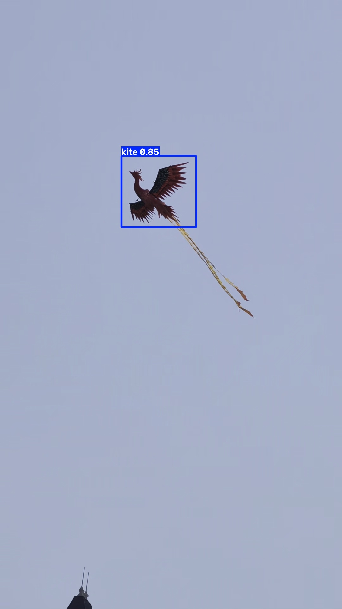
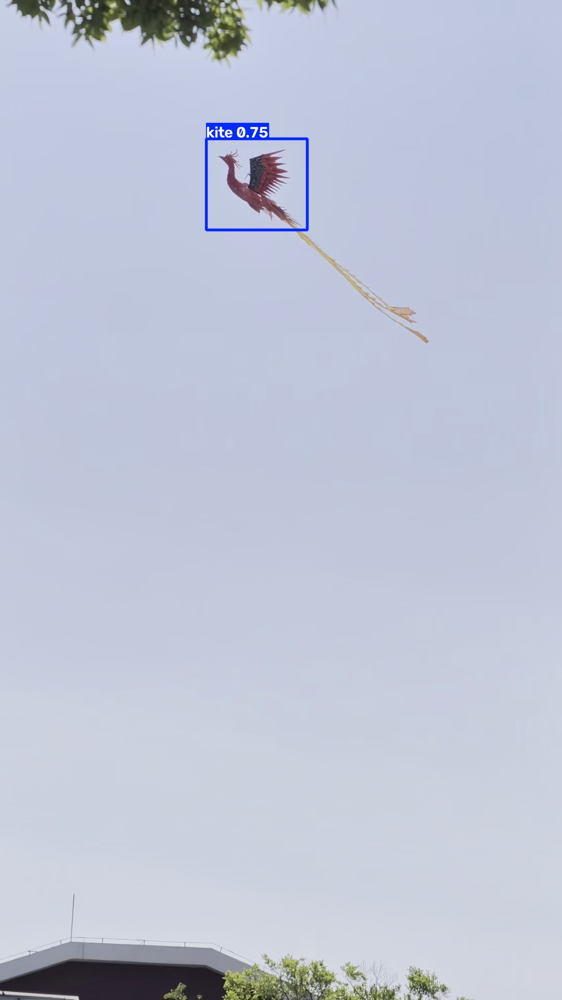
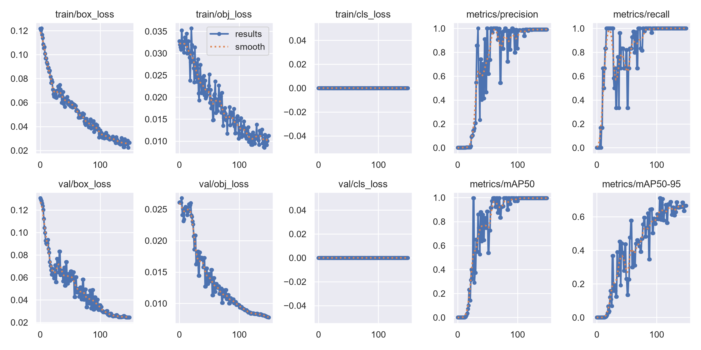

# YOLOv5 风筝目标检测 (Kite Detection)

> 计算机视觉课程作业 · YOLOv5 自定义目标检测
>
> 自选一段视频 → 抽帧 → 标注 → 训练 → 推理，完整走通 YOLOv5 自定义数据集流程。



---

## 1. 项目概述

| 项目 | 说明 |
|---|---|
| **检测目标** | `kite`（风筝）— 1 类目标 |
| **视频来源** | 手机竖屏拍摄，1080×1920，30 fps，5.6 秒，168 帧 |
| **画面内容** | 一只红色凤凰造型风筝在空中飞行，带长尾 |
| **模型** | YOLOv5s（7.0，COCO 预训练权重微调） |
| **训练数据** | 28 张标注图片（train 22 / val 6） |
| **最终精度** | mAP@0.5 = **0.995**，Precision = 0.991，Recall = 1.000 |
| **推理速度** | ~5 ms/帧 @ RTX 5070 Ti（12 GB） |

### 为什么选风筝

视频由手机俯拍天空拍摄，画面主体是一只红色凤凰风筝。用 COCO 预训练 `yolov5s` 试跑时，模型把风筝识别成 `kite`、`bird`、`airplane` 三类，置信度在 0.29~0.86 之间大幅波动 —— 因为风筝的形状与鸟类、飞行器相似，COCO 预训练模型无法稳定区分。因此**训练一个自定义单类检测器**有明确的实际意义：让模型在固定场景中稳定、高置信度地框出风筝本体。

---

## 2. 效果展示

### 2.1 推理结果（验证集图片）

| 帧 0（t=0.00s） | 帧 102（t=3.40s） |
|---|---|
|  |  |

模型框住了风筝的**身体与翅膀**，并且**正确排除了拖曳的长尾**（尾巴不计入目标，见第 4.3 节标注规范）。置信度分别为 0.75 与 0.85。

### 2.2 完整视频检测结果

`results/demo_detection.mp4` — 对原始 5.6 秒视频逐帧推理，168 帧全部检出 `kite`。

### 2.3 训练曲线



| 曲线 | 含义 |
|---|---|
| `results/PR_curve.png` | Precision-Recall 曲线 |
| `results/F1_curve.png` | F1 置信度曲线，最佳置信度阈值 |
| `results/confusion_matrix.png` | 混淆矩阵 |
| `results/labels_distribution.jpg` | 标注框尺寸和位置分布 |

---

## 3. 最终指标

| 指标 | 验证集 (6 张 / 6 个目标) |
|---|---|
| Precision | **0.991** |
| Recall | **1.000** |
| mAP@0.5 | **0.995** |
| mAP@0.5:0.95 | 0.711 |
| 训练轮数 | 150 epochs |
| 训练耗时 | 约 1.5 分钟（RTX 5070 Ti） |

> ⚠️ **指标解读**：验证集只有 6 张图片且与训练集来自**同一段视频**，因此 mAP 接近 1.0 属于正常现象，不能代表模型在新场景下的泛化能力。这组数字说明模型**充分拟合了本视频中的目标外观**，对同类场景（同款风筝、相似拍摄角度）有很好的检测效果；但换成形状完全不同的风筝或其他飞行物，效果需要重新验证。见第 7 节改进方向。

---

## 4. 数据集规范

> **数据集本身不上传仓库**（按作业要求：图片和标注文件留在本地）。本节完整记录数据规范，任何人可据此复现。

### 4.1 数据来源与抽帧

- **原始视频**：`video_20261118_153029.mp4`（1080×1920 竖屏，30.01 fps，168 帧，5.6 秒）
- **抽帧策略**：每隔 6 帧抽 1 张（约 0.2 秒/张），共 **28 张**
- **抽帧脚本**：`scripts/extract_frames.py`

```bat
python scripts\extract_frames.py ^
  --video "C:\path\to\video.mp4" ^
  --out   dataset\images\all ^
  --every 6
```

- **文件命名**：`frame_<帧号>_t<秒数>s.jpg`，例如 `frame_0102_t3.40s.jpg`（第 102 帧、第 3.40 秒）
  - 命名带帧号和时间戳，保证可回溯到视频的精确位置
- **为什么每 0.2 秒一张**：5.6 秒视频共 168 帧，逐帧标注会产生大量近乎重复的样本（无效工作量）。每 6 帧抽取一张，既覆盖风筝在整段视频中的所有姿态与位置变化（中心点 cx∈[0.32, 0.57]，cy∈[0.18, 0.33]），又把标注量控制在 28 张。

### 4.2 目录结构

```
dataset/
├── images/
│   ├── all/          # 全部 28 张原始抽取帧（标注时的工作目录）
│   ├── train/        # 22 张，训练集
│   └── val/          # 6 张，验证集
└── labels/
    ├── all/          # 28 个 .txt（与 images/all 一一对应）
    ├── train/        # 22 个
    └── val/          # 6 个
```

- **划分方式**：固定随机种子 0 打乱后按 **8 : 2** 划分
- **划分脚本**：`scripts/split_dataset.py`
- **原则**：图片与标注文件**必须同名**（仅扩展名不同），且 `train`/`val` 中**不允许出现无标注的图片**

### 4.3 标注规范

**类别**：`kite`（class_id = 0），单类。

| 要框 | 不框 |
|---|---|
| 风筝的**身体与翅膀**主体 | 风筝的**长尾飘带**（拖曳的丝带） |
| 框体**紧贴目标边缘**，不留大片背景 | 天空中的云、树梢、建筑等背景元素 |

**规则说明**：

1. **尾巴不框**。凤凰风筝的尾带长达身长的 2~3 倍，若框入尾巴，框体会覆盖大量天空背景（IoU 偏低），且尾巴会随风摆动改变形状，给回归带来噪声。只框本体能让模型聚焦于风筝的"头-翅-身"结构。
2. **框紧贴边缘**。留白会拉低 IoU，影响定位精度。
3. **目标被画面边缘截断时**，框体裁剪到画面内。
4. **低置信度/模糊帧也应标注**，只要人能辨认出风筝即可（28 张样本量偏小，应尽量保留有效样本）。
5. **纯背景帧保留空 `.txt` 文件**，用于教模型"这里没有目标"（本数据集中所有 28 帧均含风筝，无空标注）。

### 4.4 标注格式：YOLO TXT

每个 `.txt` 与同名图片配套，一行一个目标：

```
<class_id> <x_center> <y_center> <width> <height>
```

- 全部为**归一化坐标**（除以图片宽高），取值 0~1
- `class_id` 为 0（只有 `kite` 一类）
- 示例（`frame_0102_t3.40s.txt`）：

```
0 0.473923 0.320153 0.253968 0.112245
```

### 4.5 标注工具与格式转换说明

- **工具**：`labelImg` 在本机（Qt 5.15.2 + Python 3.11）绘制框体时会崩溃，且该版本仅支持 PascalVOC 输出，因此改用仓库自带的 **`scripts/label_tool.py`** —— 一个基于 Python 标准库 `tkinter` 的轻量标注工具，**直接输出 YOLO TXT**，无 Qt 依赖。
- **备选方案**：若使用 labelImg 输出 PascalVOC `.xml`，可用 `scripts/voc2yolo.py` 批量转换：

```bat
python scripts\voc2yolo.py ^
  --xml-dir dataset\labels\all ^
  --img-dir dataset\images\all ^
  --class-name kite
```

### 4.6 标注校验

`scripts/check_labels.py` 会检查：图片与标注是否一一对应、坐标是否越界、框是否过小、空标注数量。

实测结果（本数据集）：

```
images=28 labels=28
missing label: none
orphan label : none
empty txt: none
bad boxes: none
boxes=28
w  min=0.138 max=0.274 mean=0.207
h  min=0.069 max=0.130 mean=0.104
cx min=0.319 max=0.566
cy min=0.177 max=0.330
```

---

## 5. 数据集配置

`kite.yaml`（YOLOv5 数据集描述文件）：

```yaml
path: E:/dsh_yolo_hw/dataset   # 数据集根目录，使用正斜杠
train: images/train            # 相对 path
val: images/val
nc: 1                          # 类别数
names: ['kite']
```

> 路径为绝对路径的模板，复现时改成自己的数据集目录。Windows 上 YAML 中**必须用正斜杠** `/`，反斜杠会被当作转义符。

---

## 6. 复现步骤

### 6.1 环境

| 组件 | 版本 |
|---|---|
| Python | 3.11 |
| PyTorch | 2.10.0+cu128 |
| torchvision | 0.25.0+cu128 |
| CUDA | 12.8（驱动 572.90） |
| GPU | NVIDIA RTX 5070 Ti Laptop（12 GB） |
| YOLOv5 | v7.0（ultralytics/yolov5） |

```bat
conda create -n yolov5 python=3.11 -y
conda activate yolov5
pip install torch==2.10.0 torchvision==0.25.0 --index-url https://download.pytorch.org/whl/cu128
git clone https://github.com/ultralytics/yolov5.git
cd yolov5
pip install -r requirements.txt
```

### 6.2 数据准备

```bat
:: 1) 抽帧
python scripts\extract_frames.py --video 你的视频.mp4 --out dataset\images\all --every 6

:: 2) 标注（运行后拖拽画框，A/D 翻页，自动保存）
python scripts\label_tool.py --img-dir dataset\images\all --label-dir dataset\labels\all --class-name kite

:: 3) 校验标注
python scripts\check_labels.py

:: 4) 划分 train / val
python scripts\split_dataset.py
```

### 6.3 训练

```bat
cd E:\yolov5
python train.py ^
  --data    E:/dsh_yolo_hw/kite.yaml ^
  --weights yolov5s.pt ^
  --img 640 --batch 16 --epochs 150 ^
  --device 0 --workers 2 ^
  --project E:/dsh_yolo_hw/runs --name kite_yolov5s
```

**超参数**（`--hyp data/hyps/hyp.scratch-low.yaml` 默认）：

| 参数 | 值 |
|---|---|
| 优化器 | SGD，lr0=0.01，lrf=0.01，momentum=0.937 |
| 数据增强 | HSV(0.015/0.7/0.4)、随机平移 0.1、缩放 0.5、水平翻转 0.5、Mosaic 1.0 |
| 损失权重 | box=0.05，cls=0.5，obj=1.0 |
| 训练轮数 | 150 |

### 6.4 推理

```bat
:: 图片
python detect.py --weights runs/kite_yolov5s/weights/best.pt ^
  --source dataset/images/val --conf 0.25 --device 0

:: 视频
python detect.py --weights runs/kite_yolov5s/weights/best.pt ^
  --source 你的视频.mp4 --conf 0.25 --device 0
```

---

## 7. 已知问题与改进方向

### 7.1 训练末尾的绘图报错（不影响权重）

训练完成时终端会打印：

```
AttributeError: 'numpy.ndarray' object has no attribute 'save'
```

这是 YOLOv5 在 `utils/plots.py` 中用后台线程保存 `train_batch*.jpg` / `val_batch*_pred.jpg` 预览图时的兼容性问题（numpy 2.x + Pillow 13 下 `annotator.im` 返回 ndarray 而非 PIL Image），**发生在训练结束、权重已保存之后**，不影响 `best.pt` / `last.pt`。因此 `runs/` 下缺少 batch 预览图，但 `results.png`、`PR_curve.png` 等评估图正常生成。

### 7.2 改进方向

| 方向 | 说明 |
|---|---|
| **扩充数据** | 目前只有 28 张、来自单段视频。补充不同风筝、不同背景、不同光照的视频能显著提升泛化能力 |
| **验证集独立性** | 当前 val 与 train 同源，指标偏乐观。应从独立视频中抽帧做验证 |
| **多尺度/目标过小** | 风筝在画面中占比约 14%~27%（宽），若出现远处小目标，可尝试 `--img 960` 或增加小目标样本 |
| **类别扩展** | 若扩展为 `kite` + `bird` + `airplane` 多类，可训练模型区分相似飞行物，更有挑战性 |
| **导出部署** | 用 `export.py` 导出 ONNX / TensorRT 加速推理 |

---

## 8. 仓库结构

```
yolov5-kite-detection/
├── README.md
├── kite.yaml                  # YOLOv5 数据集配置
├── scripts/
│   ├── extract_frames.py      # 视频抽帧
│   ├── label_tool.py          # tkinter 轻量标注工具（直接输出 YOLO txt）
│   ├── voc2yolo.py            # PascalVOC xml → YOLO txt 转换
│   ├── split_dataset.py       # train / val 划分
│   └── check_labels.py        # 标注校验
└── results/
    ├── demo_detection.mp4     # 完整视频推理结果
    ├── pred_frame_0000.jpg    # 验证集推理示例
    ├── pred_frame_0102.jpg
    ├── training_curves.png    # results.png
    ├── PR_curve.png
    ├── F1_curve.png
    ├── confusion_matrix.png
    └── labels_distribution.jpg
```

**未上传**：`dataset/`（原始图片与标注）、`runs/`（训练产物与权重，`best.pt` 约 14 MB）。按作业要求数据集保留在本地，权重可另行提供。

---

## 9. 参考

- [Ultralytics YOLOv5](https://github.com/ultralytics/yolov5)
- [YOLOv5 训练文档](https://docs.ultralytics.com/yolov5/tutorials/train_custom_data/)
